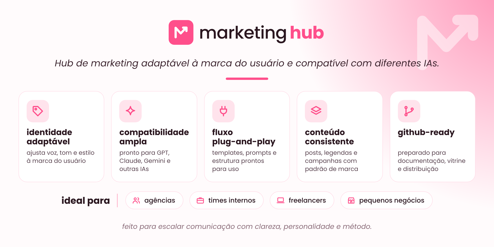

<p align="center">
  
</p>

<p align="center">
  <strong>Your marketing, in one place.</strong><br>
  Brand-aware content creation and planning, without a generic voice.
</p>
<p align="center"><a href="README.md">Português</a> · <a href="docs/instalacao.md">Installation (PT-BR)</a> · <a href="docs/compatibilidade.md">Compatibility (PT-BR)</a></p>

## What is Marketing Hub?

**Marketing Hub** is a portable editorial toolkit: one canonical Agent Skill (`skills/marketinghub/SKILL.md`) plus a self-contained text prompt (`prompts/marketinghub-universal.md`). It supports ideation, social captions, short-video scripts, content calendars, campaigns and editorial review according to the **brand information you provide**.

It integrates principles from 17 social-media methods into one workflow. It does **not** guarantee persistent brand memory, publishing, account access, verified research, or results such as virality. Available capabilities depend on the assistant and authorized tools.

## Getting started

**No installation:** open [`prompts/marketinghub-universal.md`](prompts/marketinghub-universal.md), copy its contents into an AI assistant that accepts text instructions, and tell it about your brand, audience, voice and goal.

**With a compatible local agent:** download the repository ZIP from GitHub, extract it, then run:

```bash
python scripts/install.py --platform codex --scope user
```

Supported installer targets: `codex`, `claude`, `gemini`, and `copilot` (in clients that support Agent Skills). The installer paths and archive packaging were locally tested; end-to-end behavior has **not** been verified across all providers. Read the [install guide](docs/instalacao.md) and [compatibility matrix](docs/compatibilidade.md).

For recurring brand work, use the [brand-profile template](skills/marketinghub/templates/brand-profile.template.json) or provide a short free-form briefing. Do not commit real customer profiles or confidential information.

## Project layout

```text
skills/marketinghub/               # canonical skill
prompts/marketinghub-universal.md  # portable prompt
assets/                           # owner-provided brand graphics
examples/                         # fictional examples
docs/                             # installation, compatibility, and website
scripts/                          # local installer and checks
tests/                            # automated tests
.github/                          # workflow templates
```

## Testing and contributions

```bash
python scripts/check_repo.py
python -m unittest discover -s tests -v
```

See [CONTRIBUTING.md](CONTRIBUTING.md) and [SECURITY.md](SECURITY.md). The [sample Instagram brief](examples/brief-instagram.md) is fictional, not a customer case study.

## Design assets and licensing

The banner, icon, logo variants and social preview are original **user-supplied** project assets, not AI-generated for this release. The original source bytes are preserved. See [asset provenance](assets/ASSET-PROVENANCE.md) and [brand asset terms](BRAND-ASSETS-LICENSE.md).

Code and documentation include an MIT license, subject to the owner's confirmation for public release. Brand graphics are excluded from that software license. Credits for Charlie Hills' original MIT-licensed social-media methods are in [NOTICE.md](NOTICE.md).
